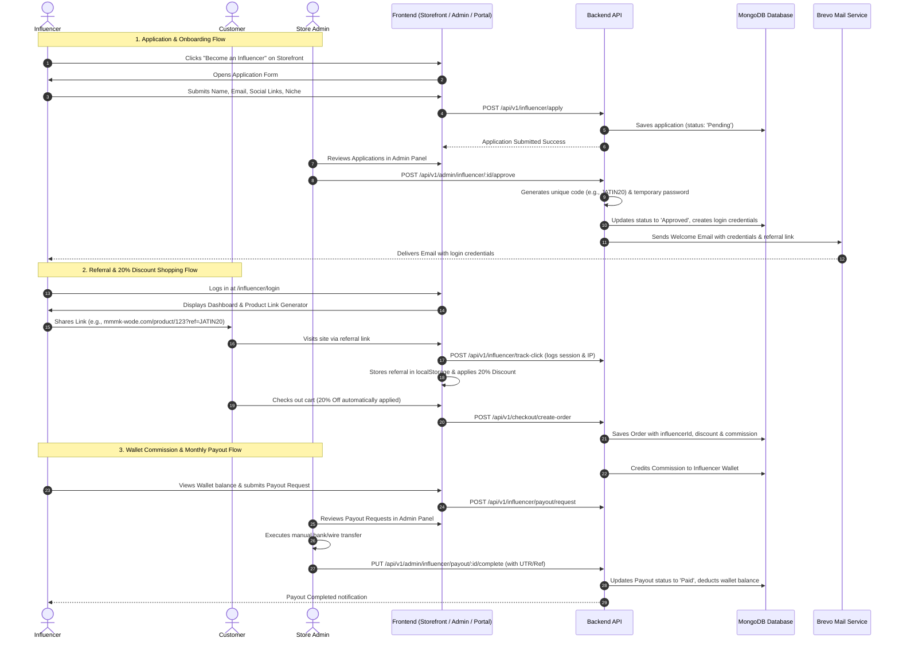

# Influencer Management & Affiliate Community System
## Architecture, Scope & Step-by-Step Implementation Plan

**Project:** MMMK-WODE E-Commerce Platform  
**Target:** Client & Manager Requirements & Codenap Scope Document (Section 6)  
**Date:** October 2026  
**Status:** All Phases 1 to 6 Successfully Implemented & Committed Locally  

---

## 1. Executive Summary & Core Objectives

This specification defines the end-to-end design and implementation of the **Influencer Link & Community System** for MMMK-WODE. The system connects three key stakeholders:
1. **The Influencer (Affiliate Partner):** Can apply via the public storefront, receive secure login credentials upon admin approval, generate custom trackable links for any product or the entire storefront, monitor real-time analytics (clicks, conversions, sales, commissions), and request monthly wallet payouts.
2. **The Referred Customer (Shopper):** When visiting via an influencer's unique referral link or entering their referral code, the shopper automatically unlocks an exclusive **20% discount** across products at checkout.
3. **The Store Admin:** Has complete visibility and control over influencer applications, credentials generation, custom commission and discount rates, real-time traffic and order attribution, conversion analytics, and manual payout approvals with transaction audit logs.

---

## 2. Requirement Matrix: Verbal Brief vs. Scope Document

| Feature | Manager / Client Verbal Brief | Codenap Scope Document (Section 6) | System Implementation |
|---|---|---|---|
| **Public Entry Point** | Button on storefront UI for influencers to apply | Influencer community onboarding | Responsive "Become an Influencer" button in Header & Footer linking to `/influencer/apply` or quick application modal |
| **Application Details** | Form with personal details and social media account links | Influencer profiles & personal details | Captures Full Name, Email, Phone, Social Media links (Instagram, YouTube, TikTok), Audience Niche & Bio |
| **Approval Flow** | Admin reviews, approves or rejects in Admin Panel | Add & manage influencers, activate / deactivate | Dedicated Admin Applications Queue with 1-click **Approve** (with credentials generation) or **Reject** (with optional note) |
| **Credentials & Email** | Username & password generated, sent to influencer's email | Create influencer accounts and login access | Auto-generates unique username, secure initial password, and custom Referral Code (e.g., `JATIN20`). Sends email via Brevo mail service |
| **Influencer Portal** | Dedicated portal where influencer logs in and sees all products | Dedicated Influencer Dashboard with catalog access | `/influencer/login` & `/influencer/dashboard` with complete product catalog, 1-click link generator, and copy-to-clipboard |
| **Link Tracking** | Unique ID per influencer, track clicks and visitors | Unique tracking link, click tracking, visitor tracking | Query parameter `?ref=CODE` or route `/ref/:code`. Logs click events, visitor sessions, and sets 30-day attribution cookie/localStorage |
| **Customer Benefit** | Customer coming via influencer gets **20% OFF** | Conversion incentives / promotion integration | Automatic 20% discount applied to cart and checkout when attributed to an active influencer |
| **Order Attribution** | Admin & Influencer see how many bought products | Order attribution, sales attribution, conversion tracking | Orders record `influencerId`, `influencerCode`, discount amount, and commission amount |
| **Commission Structure** | Influencer gets commission by end of month | Configurable percentage-based commission (e.g. 10%) | Dynamic commission rate per influencer (default 10%), automatically credited to wallet upon eligible order completion |
| **Wallet & Payouts** | Monthly commission payout | Wallet balance, payout request system, manual admin transfer | Influencer requests withdrawal once minimum threshold is met; Admin reviews and marks paid with bank transfer/UTR reference |

---

## 3. System Architecture & User Flow Diagram



---

## 4. Database Schema Design (Mongoose)

### 4.1. `Influencer.js` (Core Model)
```javascript
const influencerSchema = new mongoose.Schema({
  // Account & Credentials
  username: { type: String, required: true, unique: true, lowercase: true, trim: true },
  email: { type: String, required: true, unique: true, lowercase: true, trim: true },
  password: { type: String, required: true }, // bcrypt hashed
  fullName: { type: String, required: true, trim: true },
  phoneNumber: { type: String, trim: true },
  
  // Unique Referral Code & Slug
  referralCode: { type: String, required: true, unique: true, uppercase: true, trim: true }, // e.g. "JATIN20"
  
  // Application & Social Profiles
  socialMedia: {
    instagram: { type: String, trim: true },
    tiktok: { type: String, trim: true },
    youtube: { type: String, trim: true },
    facebook: { type: String, trim: true },
    other: { type: String, trim: true },
  },
  niche: { type: String, trim: true }, // e.g. "Luxury Fashion, Beauty, Lifestyle"
  followerCount: { type: String, trim: true },
  bio: { type: String, trim: true },
  
  // Status Lifecycle
  status: {
    type: String,
    enum: ["Pending", "Approved", "Rejected", "Suspended"],
    default: "Pending",
  },
  rejectionReason: { type: String, trim: true },
  
  // Financial Configuration
  commissionRate: { type: Number, default: 10 }, // Default 10% commission on sales
  discountRate: { type: Number, default: 20 },   // Default 20% discount for shoppers
  
  // Wallet & Earnings
  walletBalance: { type: Number, default: 0 },
  totalCommissionEarned: { type: Number, default: 0 },
  totalPaidOut: { type: Number, default: 0 },
  pendingPayoutAmount: { type: Number, default: 0 },
  
  // Banking / Payout Details
  payoutDetails: {
    payoutMethod: { type: String, enum: ["BankTransfer", "UPI", "PayPal"], default: "BankTransfer" },
    accountHolderName: { type: String, trim: true },
    accountNumber: { type: String, trim: true },
    bankName: { type: String, trim: true },
    ifscOrSwift: { type: String, trim: true },
    upiId: { type: String, trim: true },
    paypalEmail: { type: String, trim: true },
  },
  
  // Security & Audit
  lastLogin: { type: Date },
  approvedAt: { type: Date },
  approvedBy: { type: mongoose.Schema.Types.ObjectId, ref: "Admin" },
}, { timestamps: true });
```

### 4.2. `InfluencerClick.js` (Traffic & Attribution Tracking)
```javascript
const influencerClickSchema = new mongoose.Schema({
  influencerId: { type: mongoose.Schema.Types.ObjectId, ref: "Influencer", required: true },
  referralCode: { type: String, required: true },
  visitorSessionId: { type: String, index: true },
  ipAddress: { type: String },
  userAgent: { type: String },
  referrer: { type: String },
  landingUrl: { type: String },
  productId: { type: mongoose.Schema.Types.ObjectId, ref: "Product" },
  convertedToOrder: { type: Boolean, default: false },
  orderId: { type: mongoose.Schema.Types.ObjectId, ref: "Order" },
}, { timestamps: true });
```

### 4.3. `InfluencerPayoutRequest.js` (Payout Management)
```javascript
const influencerPayoutRequestSchema = new mongoose.Schema({
  influencerId: { type: mongoose.Schema.Types.ObjectId, ref: "Influencer", required: true },
  requestedAmount: { type: Number, required: true },
  payoutMethod: { type: String, enum: ["BankTransfer", "UPI", "PayPal"], required: true },
  payoutDetailsSnapshot: { type: mongoose.Schema.Types.Mixed, required: true },
  status: {
    type: String,
    enum: ["Pending", "Approved", "Paid", "Rejected"],
    default: "Pending",
  },
  adminNote: { type: String, trim: true },
  transactionReference: { type: String, trim: true }, // Bank UTR, Wire ref, receipt ID
  requestedAt: { type: Date, default: Date.now },
  processedAt: { type: Date },
  processedBy: { type: mongoose.Schema.Types.ObjectId, ref: "Admin" },
}, { timestamps: true });
```

### 4.4. `InfluencerWalletTransaction.js` (Audit Ledger)
```javascript
const influencerWalletTransactionSchema = new mongoose.Schema({
  influencerId: { type: mongoose.Schema.Types.ObjectId, ref: "Influencer", required: true },
  type: {
    type: String,
    enum: ["Commission_Credit", "Payout_Debit", "Refund_Reversal", "Manual_Adjustment"],
    required: true,
  },
  amount: { type: Number, required: true },
  balanceBefore: { type: Number, required: true },
  balanceAfter: { type: Number, required: true },
  orderId: { type: mongoose.Schema.Types.ObjectId, ref: "Order" },
  payoutRequestId: { type: mongoose.Schema.Types.ObjectId, ref: "InfluencerPayoutRequest" },
  description: { type: String, required: true },
}, { timestamps: true });
```

### 4.5. `Order.js` Schema Updates (Attribution Fields)
Add to existing `backend/models/Order.js`:
```javascript
influencerId: { type: mongoose.Schema.Types.ObjectId, ref: "Influencer" },
influencerCode: { type: String, trim: true },
influencerDiscountAmount: { type: Number, default: 0 },
influencerCommissionRate: { type: Number, default: 0 },
influencerCommissionAmount: { type: Number, default: 0 },
influencerCommissionStatus: {
  type: String,
  enum: ["None", "Pending", "Earned", "Cancelled", "Paid"],
  default: "None",
},
```

---

## 5. API Architecture & Endpoint Specification

### 5.1. Non-Auth / Public APIs (`/api/v1/influencer`)
- `POST /api/v1/influencer/apply`: Submit public influencer application form.
- `POST /api/v1/influencer/login`: Influencer authentication (returns JWT token and profile info).
- `POST /api/v1/influencer/track-click`: Track referral link click, log visitor IP/session, returns active discount info.
- `GET /api/v1/influencer/validate-code/:code`: Validates referral code, returns discount percentage (20%) and validity.

### 5.2. Influencer Portal Protected APIs (`/api/v1/influencer/...` with `isInfluencer` Auth)
- `GET /api/v1/influencer/profile`: Retrieve influencer profile, referral links, and payment settings.
- `PUT /api/v1/influencer/profile`: Update personal info, social links, or payout bank details.
- `PUT /api/v1/influencer/change-password`: Change portal password.
- `GET /api/v1/influencer/dashboard`: Get KPI summary (Total Clicks, Orders, Sales, Commission Earned, Available Balance).
- `GET /api/v1/influencer/products`: List active products with auto-generated custom referral links.
- `GET /api/v1/influencer/orders`: List all attributed orders with date, status, order value, and earned commission.
- `GET /api/v1/influencer/wallet`: Current balance, transaction history, pending payouts.
- `POST /api/v1/influencer/payout/request`: Submit a withdrawal request for available balance.
- `GET /api/v1/influencer/payout/history`: List all submitted payout requests and statuses.

### 5.3. Admin Management APIs (`/api/v1/admin/influencer/...` with `isAdmin` Auth)
- `GET /api/v1/admin/influencer/applications`: List pending applications with pagination and filters.
- `POST /api/v1/admin/influencer/applications/:id/approve`: Approve applicant, auto-generate credentials & referral code, trigger email.
- `POST /api/v1/admin/influencer/applications/:id/reject`: Reject application with optional reason.
- `GET /api/v1/admin/influencer/list`: List all influencers (active, suspended, commission rates, performance totals).
- `GET /api/v1/admin/influencer/:id`: Full details of an influencer, including clicks, orders, wallet ledger, and payout history.
- `PUT /api/v1/admin/influencer/:id`: Update status (Active/Suspended), commission %, discount %, or reset password.
- `GET /api/v1/admin/influencer/analytics`: Aggregated affiliate analytics (Total Influencers, Clicks, Orders, Revenue, Total Commission Paid).
- `GET /api/v1/admin/influencer/payouts`: List all payout requests (Pending, Approved, Paid, Rejected).
- `PUT /api/v1/admin/influencer/payouts/:id/status`: Update payout status (Approve, Reject, or Mark as Paid with Bank UTR reference).
- `GET /api/v1/admin/influencer/settings`: Get default commission %, default discount %, minimum payout threshold.
- `PUT /api/v1/admin/influencer/settings`: Update global influencer affiliate settings.

---

## 6. Frontend Component & Page Architecture

### 6.1. Storefront Integration
1. **Public "Become an Influencer" Entry Points**:
   - Navigation Link in Header dropdown / top navigation.
   - Dedicated footer column link under "Community / Partnerships".
   - Route `/influencer/apply` featuring luxury branding and an intuitive, elegant multi-step application modal.
2. **Global Referral Tracking (`useInfluencerTracking`)**:
   - Listens to URL query parameter `?ref=CODE` or `?influencer=CODE`.
   - Fires backend click tracking beacon.
   - Stores referral code in `localStorage` (`mmmk_referral_code`) with a 30-day attribution window.
   - Displays a subtle welcome banner: *"Exclusive 20% Influencer Discount Applied via [Influencer Name]!"*
3. **Checkout & Cart Discount Integration**:
   - Cart & Checkout automatically apply the 20% discount when referral code is present.
   - Customers can also manually type an influencer referral code into the coupon/promo code input field.
   - Order review summary clearly highlights: *"Influencer Discount (20% Off): -AED XX.XX"*.

### 6.2. Dedicated Influencer Portal (`/influencer/...`)
- `/influencer/login`: Sleek, dark-themed login interface matching MMMK luxury aesthetics.
- `/influencer/dashboard`: High-level metrics dashboard:
  - Total Clicks
  - Unique Visitors
  - Total Attributed Orders
  - Total Sales Volume
  - Commission Earned
  - Available Wallet Balance
- `/influencer/links`: Product catalog browser equipped with:
  - 1-click "Copy General Store Link" (`https://mmmk-wode.com?ref=CODE`)
  - 1-click "Generate Product Link" for each specific catalog product (`https://mmmk-wode.com/product/:id?ref=CODE`)
  - QR Code generator for Instagram stories / offline marketing.
- `/influencer/orders`: Real-time order attribution feed (Order ID, Date, Amount, Customer Discount, Your Commission, Status).
- `/influencer/wallet`:
  - Current Available Balance vs. Pending Clearance.
  - "Request Payout" modal (requires bank details, validates minimum threshold e.g. AED 200).
  - Payout history table with status badges (`Pending`, `Paid` with UTR/Transaction ID).
- `/influencer/profile`: Edit social links, update bank account/IBAN/UPI, change password.

### 6.3. Admin Management Suite (`/admin/influencers/...`)
- Integrated into the existing Ant Design admin sidebar (`AdminSidebar.jsx`) under an **"Influencers"** menu item.
- **Sub-pages / Tabs**:
  1. **Applications (Pending Review)**: Table displaying name, email, social links, follower count, submission date, with instant **Approve** (modal showing generated username, password, referral code) and **Reject** buttons.
  2. **Active Influencers Directory**: Searchable list with quick toggles for Active/Suspended, inline commission % editor, lifetime sales, and total commission.
  3. **Attributed Orders & Sales**: Comprehensive audit table linking every order to its referring influencer, applied 20% discount, and generated commission.
  4. **Payout Requests**: Queue of influencer withdrawal requests. Admin can view bank details, execute manual wire transfer, and click **Mark as Paid** while inputting the bank transfer reference / UTR number.
  5. **Affiliate Analytics & Settings**: Performance charts (top performing influencers, conversion rates) and configuration controls (default commission %, default customer discount %, minimum withdrawal threshold).

---

## 7. Step-by-Step Implementation Roadmap

```
Phase 1: Database Models & Schemas
├── 1.1 Create Influencer.js
├── 1.2 Create InfluencerClick.js
├── 1.3 Create InfluencerPayoutRequest.js
├── 1.4 Create InfluencerWalletTransaction.js
└── 1.5 Update Order.js with influencer attribution fields

Phase 2: Backend Controllers & Service Logic
├── 2.1 Influencer Auth & Application Controller (apply, login, password change)
├── 2.2 Brevo Email Templates (Application Received, Approval with Credentials, Payout Processed)
├── 2.3 Tracking Controller (click capture, visit logging, code validation)
├── 2.4 Commission Engine (order completion hook, wallet credit calculation)
├── 2.5 Influencer Portal Controller (dashboard stats, product catalog links, wallet, payout request)
└── 2.6 Admin Influencer Controller (applications review, influencer management, payout approval)

Phase 3: Checkout & Attribution Integration
├── 3.1 Cart & Checkout 20% Discount calculation support for influencer codes
├── 3.2 Order creation attribution hook (saving influencerId and commission on order)
└── 3.3 Payment confirmation webhook / status change hook (crediting commission to wallet)

Phase 4: Storefront UI Components
├── 4.1 "Become an Influencer" button in Header & Footer
├── 4.2 Influencer Application Modal & Page (/influencer/apply)
├── 4.3 Global Referral Hook (captures ?ref=CODE, logs click, persists to localStorage)
└── 4.4 Storefront Referral Banner ("20% discount activated via [Name]")

Phase 5: Dedicated Influencer Portal
├── 5.1 /influencer/login page
├── 5.2 Influencer Portal Layout with navigation
├── 5.3 Dashboard KPI overview
├── 5.4 Product Referral Link Generator & QR Code
├── 5.5 Orders & Sales Feed
└── 5.6 Wallet & Payout Request submission

Phase 6: Admin Influencer Management Suite
├── 6.1 Register Influencer menu in AdminSidebar.jsx
├── 6.2 Admin Applications Queue (Approve / Reject)
├── 6.3 Admin Influencer Directory & Profile Drawer
├── 6.4 Admin Payout Requests Manager (Approve, Mark as Paid with UTR)
└── 6.5 Admin Affiliate Performance & Settings
```

---

## 8. Verification & Acceptance Criteria

1. **Application & Credential Delivery**: Submitting the public form creates a pending record. Approving the application in the admin panel generates valid credentials, unique referral code, and dispatches a welcome email.
2. **Referral Link & Click Tracking**: Opening `?ref=CODE` records a click in the database without disrupting the user experience or page load speed.
3. **20% Customer Discount**: Any visitor with an active referral code automatically receives a 20% discount on cart and checkout totals.
4. **Order Attribution & Commission**: An order completed via an influencer's link attaches `influencerId` and accurately calculates the commission (e.g., 10% of subtotal).
5. **Wallet & Payout Workflow**: The commission reflects in the influencer's wallet upon order completion. When the influencer requests a payout, the admin can approve it, input the bank transfer reference, and update the wallet balance cleanly.

---
*Ready for execution upon user confirmation.*
